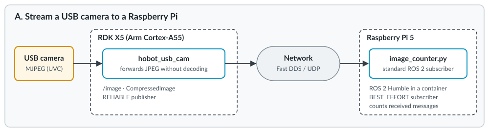

## What you will run

You will run two [TogetheROS.Bot](https://developer.d-robotics.cc/rdk_doc/en/Robot_development/tros/) vision examples on the D-Robotics RDK X5. First, you configure `hobot_usb_cam` to publish JPEG images from a USB camera. A ROS 2 subscriber on a Raspberry Pi confirms that another device can receive the topic.

Next, you run a local image-processing example: `hobot_image_pub` sends a stored image to `dnn_node_example` for object detection. You inspect how Fast DDS data sharing moves the image between these processes on the RDK X5.

The examples use different image sources: the first uses a live USB camera, and the second replays `target.jpg`. They show two integration points of a TogetheROS vision workflow. After verifying the local data-sharing step, you measure the image-processing example in two message configurations and profile its CPU work.

## About the RDK X5

The RDK X5 is part of the D-Robotics RDK (Robot Developer Kit) family. It's a developer board built on the D-Robotics Sunrise 5 chip, with an 8-core Arm Cortex-A55 processor and dedicated hardware for tasks such as neural network inference and image processing. Together with the TogetheROS.Bot robot software stack, the RDK boards are intended for building and evaluating robot prototypes.

These board features support the TogetheROS examples:

| RDK X5 feature | How this Learning Path uses it |
| --- | --- |
| 8-core Arm Cortex-A55 CPU | Runs ROS 2, the camera node, Fast DDS, and the CPU parts of image processing and inference |
| Neural network accelerator | Runs the object detection model that serves as a downstream workload in the shared-memory example |
| Image processing hardware | Resizes images for the model, through `hobot_cv` |
| 4 USB 3.0 ports | Connect the USB camera |
| Gigabit Ethernet | Carries the camera topic to the ROS 2 receiver |
| RDK OS 3.5 with TogetheROS.Bot 2.5.2 | Provides Ubuntu 22.04, ROS 2 Humble, and the TogetheROS packages |

For other hardware interfaces, see the [RDK X5 hardware introduction](https://developer.d-robotics.cc/rdk_x_doc/en/Quick_start/hardware_introduction/rdk_x5) and the [RDK documentation](https://developer.d-robotics.cc/rdk_x_doc/en/).

## ROS 2 interfaces used in the examples

If you have used ROS 2 before, the concepts are familiar:

- A **node** is a process that does one job, such as reading a camera.
- A **topic** is a named channel. Nodes publish messages to it and other nodes subscribe to it.
- A **message type** defines the data on a topic. In this Learning Path the camera publishes `sensor_msgs/msg/CompressedImage`, which carries the JPEG bytes produced by the camera.
- The **middleware (RMW)** moves messages between nodes. On both devices in this Learning Path it is eProsima Fast DDS (`rmw_fastrtps_cpp`).

If you need a refresher, see the [ROS 2 install guide](/install-guides/ros2/) and the [ROS 2 Humble documentation](https://docs.ros.org/en/humble/).

## What TogetheROS.Bot adds

TogetheROS.Bot (tros.b) is D-Robotics' robot software stack for its RDK boards. It is built on ROS 2 Humble and keeps the standard ROS 2 APIs, so standard tools such as `ros2 topic` and ordinary `rclpy` subscribers work with it. On top of ROS 2 it adds:

| Package | What it provides | Role in this Learning Path |
| --- | --- | --- |
| `hobot_usb_cam` | ROS 2 node for USB cameras | Publishes the USB camera stream |
| `hobot_shm` | Runtime environment and Fast DDS profile for shared-memory communication | Enables data sharing for the TogetheROS nodes |
| `hbm_img_msgs` | Image messages with a fixed maximum size | Carries images in the shared-memory example |
| `hobot_codec` | Image and video encoding and decoding | Encodes images for the web view in the shared-memory example. Not used on the camera path. |
| `hobot_cv` | Image processing, with platform acceleration paths. Whether hardware is used depends on the interface and the input. | Resizes images for the model in the shared-memory example |
| `dnn_node`, `dnn_node_example` | Model inference on the board's accelerator. Pre- and postprocessing can still use the CPU. | The subscriber in the shared-memory example |
| `hobot_image_publisher`, `websocket` | Publishing images from files, and browser visualization | The publisher in the shared-memory example |

## Know what runs where

The RDK X5 combines Arm CPU cores with dedicated hardware: a neural network accelerator, which D-Robotics calls the BPU, and media blocks for video codec and image processing, such as the VSE image scaling block that `hobot_cv` can use. This Learning Path focuses on the Arm CPU and the ROS 2 software. It uses the dedicated hardware only through the TogetheROS examples, and it doesn't measure the hardware's performance. Work done by those blocks is not Arm CPU work. When you read CPU numbers later in this Learning Path, keep three things apart:

- **Arm CPU work:** ROS 2 nodes, DDS serialization and transport, and any software image handling.
- **Accelerator work:** neural network inference in `dnn_node_example`.
- **Media hardware work:** hardware codec or image processing, when a pipeline uses it.

TogetheROS packages are built for D-Robotics RDK boards such as the RDK X5. The camera topic uses a standard ROS 2 message, so the receiver needs ROS 2 Humble without the TogetheROS packages.

## How you will verify each step

For the camera example, you inspect the published topic and check that a ROS 2 receiver gets its images. For the local image-processing example, you confirm that the inference node receives frames and that the processes map the same image buffer. You then measure CPU, memory, and delay. The two local message configurations use different message types and QoS settings, so their results describe those complete configurations rather than an isolated transport change.

## Summary

- TogetheROS.Bot provides the camera, image-publishing, and image-processing nodes used in these ROS 2 examples.
- The USB camera example publishes JPEG images that another ROS 2 device can receive.
- The local example feeds stored images to an inference node through Fast DDS data sharing; its publisher and subscribers share the image buffer between processes.
- The RDK X5 Arm CPU runs the ROS 2 software, while dedicated hardware handles parts of image processing and inference.

Start by recording the TogetheROS software baseline and preparing the ROS 2 receiver for the camera example.
