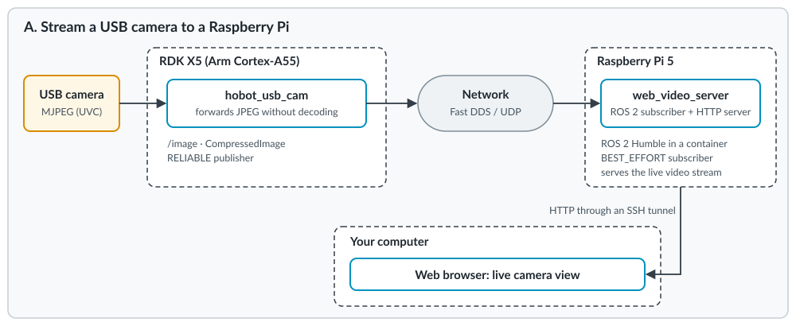
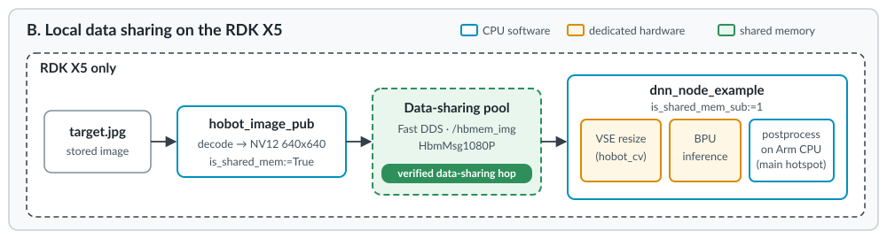

## What you will run

In this Learning Path, you will run two [TogetheROS.Bot](https://developer.d-robotics.cc/rdk_doc/en/Robot_development/tros/) vision examples on the D-Robotics RDK X5.

First, you use D-Robotics' ROS 2 camera package (`hobot_usb_cam`) to publish image frames from a USB camera connected to the RDK X5. A ROS 2 receiver on the Raspberry Pi then serves the live stream to your computer's browser through an SSH tunnel.

Next, you will run a local image-processing example on the RDK X5 alone, where `hobot_image_pub` sends a sample image to `dnn_node_example` for object detection. You will inspect how Fast DDS data sharing moves the image between two processes on the same device.

## About the RDK X5

The RDK X5 is part of the D-Robotics RDK (Robot Developer Kit) family. It's a developer board built on the D-Robotics Sunrise 5 chip, with an 8-core Arm Cortex-A55 processor and dedicated hardware for tasks such as neural network inference and image processing.

D-Robotics RDK X5 development board

To help with this Learning Path, the board features the following:

- **8-core Arm Cortex-A55 CPU**: Runs ROS 2, the camera node, Fast DDS, and the CPU parts of image processing and inference
- **Neural network accelerator**: Runs the object detection model that serves as a downstream workload in the shared-memory example
- **[Video Scale Engine (VSE)](https://developer.d-robotics.cc/sdk_doc/versions/2.0.0/en/multimedia_development/6-VSE_API_zh_CN.html)**: Resizes images for the model, through `hobot_cv`
- **4 USB 3.0 ports**: Connects the USB camera

For other hardware interfaces, see the [RDK X5 hardware introduction](https://developer.d-robotics.cc/rdk_x_doc/en/Quick_start/hardware_introduction/rdk_x5) and the [RDK documentation](https://developer.d-robotics.cc/rdk_x_doc/en/).

## ROS 2 and TogetheROS.Bot

If you have used ROS 2 before, the concepts below should be familiar:

- A **node** is a process that does one job, such as reading a camera.
- A **topic** is a named channel. Nodes publish messages to it and other nodes subscribe to it.
- A **message type** defines the data on a topic. In this Learning Path the camera publishes `sensor_msgs/msg/CompressedImage`, which carries the JPEG bytes produced by the camera.
- The **middleware (RMW)** moves messages between nodes.

If you need a refresher, see the [ROS 2 install guide](/install-guides/ros2/) and the [ROS 2 Humble documentation](https://docs.ros.org/en/humble/).

**TogetheROS.Bot** (tros.b) is D-Robotics' robot software stack for its RDK boards. It is built on ROS 2 Humble and keeps the standard ROS 2 APIs, so standard tools such as `ros2 topic` and ordinary `rclpy` subscribers work with it.

Read more about the available packages in the [TogetheROS.Bot documentation](https://developer.d-robotics.cc/tros_doc/en/tros).

## Summary

The RDK X5 combines Arm CPU cores with specialized hardware for image resizing and neural network inference. TogetheROS.Bot makes these capabilities available through ROS 2 packages.

Next, you will prepare the X5 and Raspberry Pi and check that they can exchange messages before running the two vision examples.
