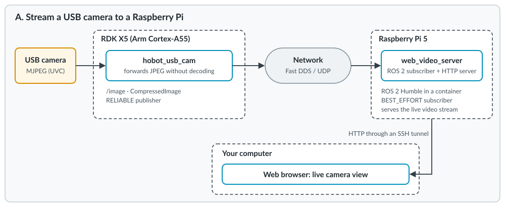
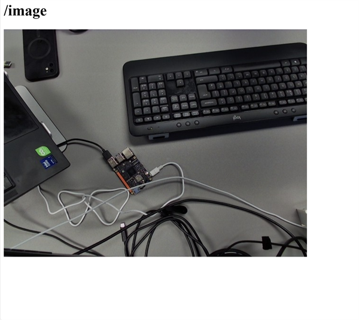

## Overview

The camera produces a sequence of JPEG images. Each ROS 2 message carries one frame. Displaying these frames as they arrive gives you a live video stream. In all, the flow would be as follows: The camera connects via USB to the RDK X5, the ROS 2 receiver runs on the Raspberry Pi, and your computer displays the stream through an SSH tunnel to the Pi.



## Find the camera device and its modes

Connect the USB camera to a USB port on the RDK X5. On the **RDK X5**, list the video devices:

```bash
v4l2-ctl --list-devices
```

This Learning Path uses a Lenovo Performance Camera. The command produces the following output:

```output
Lenovo Performance Camera: Leno (usb-xhci-hcd.2.auto-1.3):
	/dev/video0
	/dev/video1
	/dev/video2
	/dev/video3
	/dev/media0
	/dev/media1
```

Next, check the formats, resolutions, and frame rates supported by your camera:

```bash
v4l2-ctl -d /dev/video0 --list-formats-ext
```

```output
	[0]: 'MJPG' (Motion-JPEG, compressed)
		Size: Discrete 640x480
			Interval: Discrete 0.033s (30.000 fps)
			Interval: Discrete 0.042s (24.000 fps)
		...
		Size: Discrete 1280x720
			Interval: Discrete 0.033s (30.000 fps)
		...
		Size: Discrete 1920x1080
			Interval: Discrete 0.033s (30.000 fps)
```

The following example uses `/dev/video0` with MJPEG at 640x480 and 30 frames per second. Use a device and mode supported by your camera.

## Start the camera node on the RDK X5

On the **RDK X5**, use the terminal where you sourced TogetheROS and set `ROS_DOMAIN_ID=42`. Start the camera at 640x480 and 30 frames per second:

```bash
ros2 launch hobot_usb_cam hobot_usb_cam.launch.py \
  usb_video_device:=/dev/video0 \
  usb_image_width:=640 usb_image_height:=480 \
  usb_pixel_format:=mjpeg
```

The launch prints the camera's supported formats and startup messages. With the default Fast DDS profile, the output includes:

```output
Hobot shm pkg enables zero-copy with fastrtps profiles file: /opt/tros/humble/lib/hobot_shm/config/shm_fastdds.xml
Hobot shm pkg sets RMW_FASTRTPS_USE_QOS_FROM_XML: 1
[INFO] [hobot_usb_cam-1]: process started with pid [19494]
[hobot_usb_cam-1] [WARN] [...] [hobot_usb_cam]: framerate: 30
[hobot_usb_cam-1] [WARN] [...] [hobot_usb_cam]: pixel_format_name: mjpeg
[hobot_usb_cam-1] [WARN] [...] [hobot_usb_cam]: Camera calibration file: [...] does not exist!
```

The calibration warning is expected. The node still publishes images. The two `Hobot shm` lines show that the launch file loads a TogetheROS Fast DDS profile. On the next page, you inspect that profile and verify data sharing in a local image-processing example. These log lines alone don't establish which transport this camera topic uses.

{}
The launch file defaults to `/dev/video8` and 960x480. Always pass `usb_video_device`, `usb_image_width`, and `usb_image_height` to match your camera.
{}

## (Optional) Inspect the topic on the RDK X5

To prove the frames are being published, open a second RDK X5 terminal, source the environment, and list the topics with their types. If you used the [unicast fallback](/learning-paths/cross-platform/togetheros_vision/2_prepare_environment/#fallback-use-unicast-discovery-when-multicast-is-unavailable), repeat that setup in this new terminal:

```bash
source /opt/tros/humble/setup.bash
export ROS_DOMAIN_ID=42
ros2 topic list -t
```

```output
/camera_info [sensor_msgs/msg/CameraInfo]
/image [sensor_msgs/msg/CompressedImage]
/parameter_events [rcl_interfaces/msg/ParameterEvent]
/rosout [rcl_interfaces/msg/Log]
```

The camera publishes `sensor_msgs/msg/CompressedImage`. Each message carries the JPEG bytes that the camera produced. The RDK X5 doesn't decode the image on this path, so no decode work runs on the RDK X5 CPU or on its hardware codec.

## View the stream from the Raspberry Pi

Use [web_video_server](https://github.com/RobotWebTools/web_video_server#readme) as the ROS 2 receiver on the Pi. It subscribes to the camera topic and serves a live view over HTTP.

In the same **Pi container** where you [installed the live-view packages](/learning-paths/cross-platform/togetheros_vision/2_prepare_environment/#install-the-live-view-packages), start the viewer:

```bash
source /opt/ros/humble/setup.bash
ros2 run web_video_server web_video_server --ros-args \
  -p address:=127.0.0.1 \
  -r /image/compressed:=/image
```

The viewer expects compressed frames on `/image/compressed`. The remap connects that subscription to the camera's `/image` topic. Leave this command running.

The server listens on port 8080 on the Pi's loopback interface. Because the container uses `--net=host`, the Pi host can reach it.

### Open the live view on your computer

In a new terminal on **your computer**, open an SSH tunnel to the **Raspberry Pi**. Replace `PI_USER` and `PI_IP` with the username and address you use to log in to the Pi:

```bash
ssh -N -L 8080:127.0.0.1:8080 PI_USER@PI_IP
```

Leave the tunnel running. In your computer's browser, open the [live camera view](http://localhost:8080/stream_viewer?topic=/image&type=mjpeg&default_transport=compressed&qos_profile=sensor_data).




{}
If you want to view the stream from a browser on the Pi's own desktop, open the same URL there without the SSH tunnel.
{}

To stop the stream, first, close the browser tab. Press Ctrl+C in the Pi viewer terminal, the SSH tunnel terminal, and the X5 camera terminal.

## Troubleshooting

| Symptom | Check |
| --- | --- |
| No `/dev/video*` device for the camera | Run `lsusb` to confirm that the camera is detected, and `id` to confirm that your user is in the `video` group |
| Camera launch fails | Use a device, resolution, and frame rate listed by `v4l2-ctl --list-formats-ext` |
| `/image` doesn't appear on the Pi | Check `ROS_DOMAIN_ID` and repeat the discovery test or unicast fallback from the previous page |
| Browser can't connect | Keep the viewer and SSH tunnel running. The tunnel must connect to the Pi, where the viewer runs |
| Page opens but no video appears | Keep the camera running, use the complete viewer URL, and check that the viewer command includes `-r /image/compressed:=/image` |
| Video freezes or arrives slowly | Check the network connection and keep `qos_profile=sensor_data` in the URL. Try a lower resolution or frame rate supported by your camera |
| SSH reports that local port 8080 is in use | Use `-L 8081:127.0.0.1:8080` and change the browser URL to use port 8081 |

## Summary

You have:

- Started `hobot_usb_cam` with a device and image mode supported by your camera.
- Received its ROS 2 `CompressedImage` topic on the Raspberry Pi.
- Viewed the live camera stream in your computer's browser through an SSH tunnel to the Pi.

Next, use a separate stored-image example to inspect local image sharing and object detection on the RDK X5.
