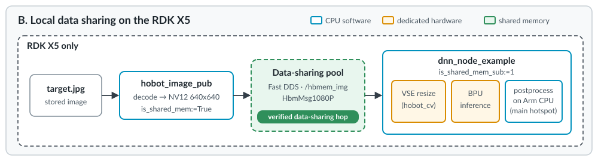

## Overview

Path B runs entirely on the RDK X5. A TogetheROS image publisher sends a stored image to an object detection node through Fast DDS data sharing. The detection node is a realistic downstream workload; this page focuses on how the images reach it.



You then collect three kinds of evidence and check which claims each one supports:

1. **Delivery:** the subscriber receives the images.
2. **Configuration:** the nodes ask for shared memory.
3. **Transport:** the publisher and subscribers actually map the same shared-memory buffer.

The Raspberry Pi isn't used in path B.

## How TogetheROS enables shared memory

The `hobot_shm` package configures Fast DDS for shared memory. The camera launch file on the previous page included it, and so does the launch file on this page. It sets these environment variables for the nodes in the launch:

| Variable | Value | Effect |
| --- | --- | --- |
| `FASTRTPS_DEFAULT_PROFILES_FILE` | `/opt/tros/humble/lib/hobot_shm/config/shm_fastdds.xml` | Loads the Fast DDS profile |
| `RMW_FASTRTPS_USE_QOS_FROM_XML` | `1` | Lets the XML profile set the history memory policy and the publication mode. QoS policies that a node sets in code, such as reliability and history depth, still take effect unless the node uses `SYSTEM_DEFAULT`. |
| `ROS_DISABLE_LOANED_MESSAGES` | `0` | Allows loaned messages |

View the profile:

```bash
cat /opt/tros/humble/lib/hobot_shm/config/shm_fastdds.xml
```

```output
<profiles xmlns="http://www.eprosima.com/XMLSchemas/fastRTPS_Profiles">
    <data_writer profile_name="default publisher profile" is_default_profile="true">
        <qos>
            <publishMode>
                <kind>ASYNCHRONOUS</kind>
            </publishMode>
            <data_sharing>
                <kind>AUTOMATIC</kind>
            </data_sharing>
        </qos>
        <historyMemoryPolicy>PREALLOCATED_WITH_REALLOC</historyMemoryPolicy>
    </data_writer>
    <data_reader profile_name="default subscription profile" is_default_profile="true">
        <qos>
            <data_sharing>
                <kind>AUTOMATIC</kind>
            </data_sharing>
        </qos>
        <historyMemoryPolicy>PREALLOCATED_WITH_REALLOC</historyMemoryPolicy>
    </data_reader>
</profiles>
```

With data sharing set to `AUTOMATIC`, Fast DDS keeps samples in a shared-memory pool owned by the publisher's DataWriter. When a subscriber is in another process on the same host, it reads samples from that pool instead of receiving a serialized copy over a socket. Fast DDS uses data sharing only on the same host, and only for message types with a fixed maximum size.

## Run the example

The main launch file of `dnn_node_example` can use a stored image instead of a camera when you set `CAM_TYPE=fb`. In that mode it starts `hobot_image_publisher` to publish the image continuously. This is different from `dnn_node_example_feedback.launch.py`, which runs inference on a single local image and doesn't publish a topic stream. Run the example from an empty working directory, because the launch file copies its `config` folder into the current directory:

```bash
mkdir -p ~/lp1_shm && cd ~/lp1_shm
source /opt/tros/humble/setup.bash
export ROS_DOMAIN_ID=42
export CAM_TYPE=fb
ros2 launch dnn_node_example dnn_node_example.launch.py \
  dnn_example_config_file:=config/fcosworkconfig.json
```

In this mode, the image size comes from `config/target.jpg`, which is 640x640. The launch file's image width and height arguments aren't passed to the image publisher.

This launch file starts four nodes:

| Node | Role | Shared-memory setting |
| --- | --- | --- |
| `hobot_image_pub` | Publishes `config/target.jpg` as NV12 to `/hbmem_img`, 5 times per second | `is_shared_mem: True` |
| `dnn_example_node` | Runs an object detection model on the board's accelerator and publishes the results | `is_shared_mem_sub: 1` |
| `hobot_codec_encoder_*` | Encodes `/hbmem_img` to JPEG on `/image` for the web view | Input mode `shared_mem` |
| `websocket` | Serves a web page with the image and detections | Not used here |

The log shows the subscriber settings and the loaded model:

```output
[example-3]  feed_type(0:local, 1:sub): 1
[example-3]  is_shared_mem_sub: 1
[example-3]  config_file: config/fcosworkconfig.json
[example-3]  sharedmem_img_topic_name: /hbmem_img
[example-3]  model_file_name: /opt/hobot/model/x5/basic/fcos_512x512_nv12.bin
[hobot_codec_republish-2] [WARN] [...] [hobot_codec_encoder_8139f206]: Enabling zero-copy
```

{}
The `websocket` launch file starts a separate `nginx` web server that keeps running after you stop the launch with Ctrl+C. When you finish this page, stop only the instance that this example started, as shown at the end of the page.
{}

## Evidence 1: the subscriber receives images

In a second RDK X5 terminal, source the environment, set `ROS_DOMAIN_ID=42`, and list the topics:

```bash
ros2 topic list -t
```

```output
/hbmem_img [hbm_img_msgs/msg/HbmMsg1080P]
/hobot_dnn_detection [ai_msgs/msg/PerceptionTargets]
/hobot_dnn_detection_info [ai_msgs/msg/PerceptionInfo]
/image [sensor_msgs/msg/CompressedImage]
/parameter_events [rcl_interfaces/msg/ParameterEvent]
/rosout [rcl_interfaces/msg/Log]
```

Check the detection output rate:

```bash
ros2 topic hz /hobot_dnn_detection
```

```output
average rate: 4.991
	min: 0.183s max: 0.220s std dev: 0.00698s window: 46
```

The inference node also logs each received frame and its processing times:

```output
[example-3] [WARN] [...] [dnn_example_node]: Recved img encoding: nv12, h: 640, w: 640, step: 0, index: 232, stamp: ..., data size: 614400, comm delay [0.7561]ms
[example-3] [WARN] [...] [dnn_example_node]: Sub img fps: 5.00, Smart fps: 5.00, recved img time delay ms: 0, pre process time ms: 7, infer time ms: 4, post process time ms: 14, pipeline time ms: 30
```

Each frame is a 640x640 NV12 image of 614,400 bytes. The node receives 5 frames per second and publishes detections at the same rate.

This evidence shows that images reach the subscriber. It doesn't show how they travel.

## Evidence 2: the configuration asks for shared memory

You've already seen three parts of this evidence:

- The publisher runs with `is_shared_mem: True` and the subscriber with `is_shared_mem_sub: 1`.
- The Fast DDS profile sets data sharing to `AUTOMATIC`.
- The codec node logs `Enabling zero-copy`.

The last requirement is a fixed-size message type. Check the definition of the message on `/hbmem_img`:

```bash
ros2 interface show hbm_img_msgs/msg/HbmMsg1080P | grep -vE "^#|^$"
```

```output
int32 index
builtin_interfaces/Time time_stamp
	int32 sec
	uint32 nanosec
uint32 height
uint32 width
uint32 data_size
uint32 step
uint8[12] encoding
uint8[6220800] data
uint32 MAX_SIZE=6220800
```

The `data` field is a fixed array of 6,220,800 bytes, enough for a 1920x1080 image with 3 bytes per pixel. Smaller images use only the first `data_size` bytes. A standard `sensor_msgs/msg/Image` uses a variable-length array, so it doesn't meet this requirement.

This evidence shows that the nodes request shared memory and that the message type allows it. It still doesn't prove that shared memory is in use.

## Evidence 3: the processes map the same buffer

Fast DDS creates each DataWriter's data-sharing pool as a file in `/dev/shm`, named after the writer's GUID. You can check which processes map it.

First, get the GID of the `/hbmem_img` publisher:

```bash
ros2 topic info -v /hbmem_img | grep -E "Node name|Endpoint type|GID"
```

```output
Node name: hobot_image_pub
Endpoint type: PUBLISHER
GID: 01.0f.a8.ee.42.75.90.30.00.00.00.00.00.00.12.03.00.00.00.00.00.00.00.00
Node name: hobot_codec_encoder_8848c0a1
Endpoint type: SUBSCRIPTION
GID: 01.0f.a8.ee.44.75.95.99.00.00.00.00.00.00.1e.04.00.00.00.00.00.00.00.00
Node name: dnn_example_node
Endpoint type: SUBSCRIPTION
GID: 01.0f.a8.ee.46.75.8a.ea.00.00.00.00.00.00.14.04.00.00.00.00.00.00.00.00
```

Then find the large data-sharing pools and the processes that map them:

```bash
PUB=$(pgrep -f "^/opt/tros/humble/lib/hobot_image_publisher/hobot_image_pub")
SUB=$(pgrep -f "^/opt/tros/humble/lib/dnn_node_example/example")
ENC=$(pgrep -f "^/opt/tros/humble/lib/hobot_codec/hobot_codec_republish")
for f in $(find /dev/shm -name "fast_datasharing_*" -size +1M); do
  echo "$(stat -c %s $f) $f"
  for p in $PUB $SUB $ENC; do
    grep -q "$f" /proc/$p/maps && echo "   mapped by $p $(cat /proc/$p/comm) $(grep "$f" /proc/$p/maps | awk '{print $2}' | sort -u)"
  done
done
```

```output
37327756 /dev/shm/fast_datasharing_01.0f.a8.ee.42.75.90.30.00.00.00.00_0.0.12.3
   mapped by 30018 hobot_image_pub rw-s
   mapped by 30022 example r--s
   mapped by 30020 hobot_codec_rep r--s
```

Read the result:

- The file name contains the publisher's GUID prefix `01.0f.a8.ee.42.75.90.30` and entity `0.0.12.3`, which matches the publisher GID ending in `12.03`. This is the pool of the `/hbmem_img` DataWriter.
- The pool is 37,327,756 bytes, about six `HbmMsg1080P` samples of 6,220,800 bytes each.
- The publisher maps the pool read-write (`rw-s`). Both subscribers map the same file read-only (`r--s`).

The subscribers read image samples directly from the publisher's shared pool. The transfer from publisher to subscriber doesn't go through a socket or a serialized copy.

## Where the shared-memory boundary is

The `/dev/shm` evidence covers one step: the hop from the publisher to the subscribers. The other steps in the pipeline still copy image data:

| Step | What happens to the image data | Evidence |
| --- | --- | --- |
| Publisher decodes `target.jpg` to NV12 | The publisher keeps the decoded image in its own cache | Not measured |
| Publisher fills the loaned sample | Copy: the cached image is copied with `memcpy` into a message borrowed with `borrow_loaned_message()`, then published | `hobot_image_publisher` 2.2.1 source code. D-Robotics confirmed that the loaned buffer is in the data-sharing pool. |
| Publisher to subscribers | Shared: the subscribers read the sample from the publisher's pool, with no copy between the processes | `/dev/shm` mappings on this page |
| Subscriber resizes the image with `hobot_cv` | Copy into the VSE input buffer, then copy of the VSE output back to a CPU buffer | `hobot_cv` source code, and the profile on the last page |
| Subscriber builds the model input | Allocates accelerator-accessible memory and copies the Y and UV planes | `dnn_node` source code, and the profile on the last page |
| Subscribers without the TogetheROS profile, or on another host | Use the normal Fast DDS transports | Fast DDS behavior |

Use the same wording when you describe this example: the publisher and the subscribers share the image buffer through Fast DDS data sharing. Don't describe the whole pipeline as "zero-copy".

## Observe the cost on the CPU

Sample the three processes for 20 seconds:

```bash
pidstat -h -u -r -p $PUB,$SUB,$ENC 1 20
```

The averages measured for this Learning Path at 5 frames per second, with 640x640 images and the default `schedutil` CPU governor. This launch file also runs the codec and web nodes, so treat these numbers as a first look. The next page measures the publisher and the inference node alone, under controlled conditions:

| Process | CPU (100% = one core) | RSS |
| --- | --- | --- |
| `hobot_image_pub` | 0.8% | 77 MB |
| `hobot_codec_republish` | 2.2% | 26 MB |
| `example` (`dnn_example_node`) | 15.4% | 72 MB |

The detection node uses the most CPU, but the neural network itself runs on the accelerator, so that part of the work isn't Arm CPU time. The CPU time in this node comes from preprocessing, from postprocessing that decodes the model output into boxes, and from ROS 2 work. You confirm this with a profiler on the last page.

These numbers describe this example only. The publisher runs at 5 frames per second from a stored image, and the subscriber runs inference. The camera path on the previous page has a different source, rate, and workload, so you can't compare these numbers with the camera path's numbers to measure the benefit of shared memory.

## Stop the example

Stop the launch with Ctrl+C. Then find the `nginx` master process that the `websocket` node started:

```bash
pgrep -a -f "nginx: master process ./sbin/nginx -p ."
```

```output
14282 nginx: master process ./sbin/nginx -p .
```

Stop that process by its PID. The worker processes exit with it:

```bash
kill <PID>
```

## What you have learned

You have:

- Seen how `hobot_shm` enables Fast DDS data sharing for TogetheROS nodes.
- Run a shared-memory image pipeline that feeds an object detection node on the RDK X5.
- Collected delivery, configuration, and transport evidence, and stated which steps use shared memory.

On the next page, you compare this data-sharing mode with standard `sensor_msgs/msg/Image` messages on the RDK X5.
