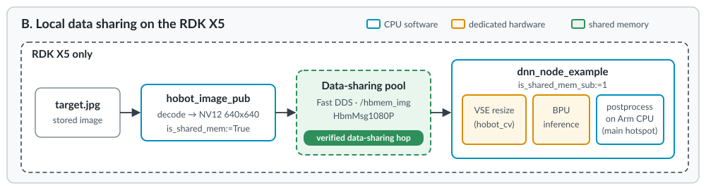
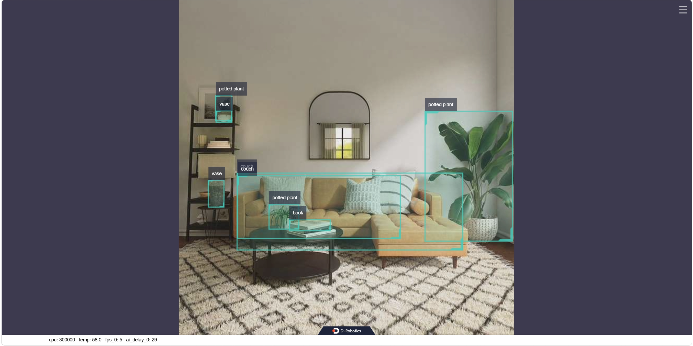

## Overview

Passing large data between separate processes on a single device can involve serialization and memory copies, which consume CPU time and memory bandwidth. TogetheROS.Bot uses ROS 2 with Fast DDS to allow local publishers and subscribers to access the same image buffer. This avoids copies during that delivery step.

In this example, a TogetheROS publisher repeatedly sends `target.jpg` to an object detection node on the RDK X5. Using a stored image keeps the input consistent while you check how the two processes share the image data.



You then collect three kinds of evidence that prove:

1. **Delivery:** the subscriber receives the images.
2. **Configuration:** the nodes ask for shared memory.
3. **Transport:** the publisher and subscribers actually map the same shared-memory buffer.

This example runs entirely on the RDK X5.

## Run the example

The main launch file of `dnn_node_example` can use a stored image instead of a camera when you set `CAM_TYPE=fb`. In that mode it starts `hobot_image_publisher` to publish the image continuously. Run the example from an empty working directory on **the RDK X5**:

```bash
unset FASTRTPS_DEFAULT_PROFILES_FILE FASTDDS_DEFAULT_PROFILES_FILE RMW_FASTRTPS_USE_QOS_FROM_XML
mkdir -p ~/lp1_shm && cd ~/lp1_shm
source /opt/tros/humble/setup.bash
export ROS_DOMAIN_ID=42
export CAM_TYPE=fb
ros2 launch dnn_node_example dnn_node_example.launch.py \
  dnn_example_config_file:=config/fcosworkconfig.json
```

The `unset` command clears any unicast fallback overrides so the launch can load the TogetheROS shared-memory profile.

This launch file starts four nodes:

| Node | Role | Shared-memory setting |
| --- | --- | --- |
| `hobot_image_pub` | Publishes `config/target.jpg` as NV12 to `/hbmem_img`, 5 times per second | `is_shared_mem: True` |
| `dnn_example_node` | Runs an object detection model on the board's accelerator and publishes the results | `is_shared_mem_sub: 1` |
| `hobot_codec_encoder_*` | Encodes `/hbmem_img` to JPEG on `/image` for the web view | Input mode `shared_mem` |
| `websocket` | Serves a web page with the image and detections | Image input mode `mjpeg` |

The log shows the subscriber settings and the loaded model:

```output
[example-3]  feed_type(0:local, 1:sub): 1
[example-3]  is_shared_mem_sub: 1
[example-3]  config_file: config/fcosworkconfig.json
[example-3]  sharedmem_img_topic_name: /hbmem_img
[example-3]  model_file_name: /opt/hobot/model/x5/basic/fcos_512x512_nv12.bin
[hobot_codec_republish-2] [WARN] [...] [hobot_codec_encoder_8139f206]: Enabling zero-copy
```

## View the image

The launch also starts a web viewer. Leave the example running and open `http://X5_IP:8000/TogetheROS/` in your computer's browser, replacing `X5_IP` with the RDK X5's IP address.

You should see `target.jpg` with bounding boxes around the detected objects.



{}
The `websocket` launch file starts a separate `nginx` web server that keeps running after you stop the launch with Ctrl+C. When you finish this page, stop only the instance that this example started, as shown at the end of the page.
{}

## Evidence 1: the subscriber receives images

In a second RDK X5 terminal, source the environment, set `ROS_DOMAIN_ID=42`, and list the topics:

```bash
source /opt/tros/humble/setup.bash
export ROS_DOMAIN_ID=42
ros2 topic list -t
```

```output
/hbmem_img [hbm_img_msgs/msg/HbmMsg1080P]
/hobot_dnn_detection [ai_msgs/msg/PerceptionTargets]
/hobot_dnn_detection_info [ai_msgs/msg/PerceptionInfo]
/image [sensor_msgs/msg/CompressedImage]
/parameter_events [rcl_interfaces/msg/ParameterEvent]
/rosout [rcl_interfaces/msg/Log]
```

Check the detection output rate:

```bash
ros2 topic hz /hobot_dnn_detection
```

```output
average rate: 4.991
	min: 0.183s max: 0.220s std dev: 0.00698s window: 46
```

The inference node also logs each received frame and its processing times:

```output
[example-3] [WARN] [...] [dnn_example_node]: Recved img encoding: nv12, h: 640, w: 640, step: 0, index: 232, stamp: ..., data size: 614400, comm delay [0.7561]ms
[example-3] [WARN] [...] [dnn_example_node]: Sub img fps: 5.00, Smart fps: 5.00, recved img time delay ms: 0, pre process time ms: 7, infer time ms: 4, post process time ms: 14, pipeline time ms: 30
```

Each frame is a 640x640 NV12 image of 614,400 bytes. The node receives 5 frames per second and publishes detections at the same rate.

This evidence shows that images reach the subscriber.

## Evidence 2: the configuration asks for shared memory

The launch uses `hobot_shm` to load the Fast DDS profile. Check its data-sharing settings:

```bash
grep -A 2 '<data_sharing>' /opt/tros/humble/lib/hobot_shm/config/shm_fastdds.xml
```

```output
            <data_sharing>
                <kind>AUTOMATIC</kind>
            </data_sharing>
--
            <data_sharing>
                <kind>AUTOMATIC</kind>
            </data_sharing>
```

Both publisher and subscriber profiles use `AUTOMATIC`, which allows data sharing when its requirements are met. The launch settings and log also show:

- The publisher runs with `is_shared_mem: True` and the subscriber with `is_shared_mem_sub: 1`.
- The codec node logs `Enabling zero-copy`.

The last requirement is a fixed-size message type. Check the definition of the message on `/hbmem_img`:

```bash
ros2 interface show hbm_img_msgs/msg/HbmMsg1080P | grep -vE "^#|^$"
```

```output
int32 index
builtin_interfaces/Time time_stamp
	int32 sec
	uint32 nanosec
uint32 height
uint32 width
uint32 data_size
uint32 step
uint8[12] encoding
uint8[6220800] data
uint32 MAX_SIZE=6220800
```

The `data` field is a fixed array of 6,220,800 bytes, enough for a 1920x1080 image with 3 bytes per pixel. Smaller images use only the first `data_size` bytes. A standard `sensor_msgs/msg/Image` uses a variable-length array, so it doesn't meet this requirement.

This evidence shows that the nodes request shared memory and that the message type allows it. It still doesn't prove that shared memory is in use.

## Evidence 3: the processes map the same buffer

Fast DDS creates each DataWriter's data-sharing pool as a file in `/dev/shm`, named after the writer's GUID. You can check which processes map it.

First, get the GID of the `/hbmem_img` publisher:

```bash
ros2 topic info -v /hbmem_img | grep -E "Node name|Endpoint type|GID"
```

```output
Node name: hobot_image_pub
Endpoint type: PUBLISHER
GID: 01.0f.a8.ee.42.75.90.30.00.00.00.00.00.00.12.03.00.00.00.00.00.00.00.00
Node name: hobot_codec_encoder_8848c0a1
Endpoint type: SUBSCRIPTION
GID: 01.0f.a8.ee.44.75.95.99.00.00.00.00.00.00.1e.04.00.00.00.00.00.00.00.00
Node name: dnn_example_node
Endpoint type: SUBSCRIPTION
GID: 01.0f.a8.ee.46.75.8a.ea.00.00.00.00.00.00.14.04.00.00.00.00.00.00.00.00
```

Then find the large data-sharing pools and the processes that map them:

```bash
PUB=$(pgrep -f "^/opt/tros/humble/lib/hobot_image_publisher/hobot_image_pub")
SUB=$(pgrep -f "^/opt/tros/humble/lib/dnn_node_example/example")
ENC=$(pgrep -f "^/opt/tros/humble/lib/hobot_codec/hobot_codec_republish")
for f in $(find /dev/shm -name "fast_datasharing_*" -size +1M); do
  echo "$(stat -c %s $f) $f"
  for p in $PUB $SUB $ENC; do
    grep -q "$f" /proc/$p/maps && echo "   mapped by $p $(cat /proc/$p/comm) $(grep "$f" /proc/$p/maps | awk '{print $2}' | sort -u)"
  done
done
```

```output
37327756 /dev/shm/fast_datasharing_01.0f.a8.ee.42.75.90.30.00.00.00.00_0.0.12.3
   mapped by 30018 hobot_image_pub rw-s
   mapped by 30022 example r--s
   mapped by 30020 hobot_codec_rep r--s
```

Read the result:

- The file name contains the publisher's GUID prefix `01.0f.a8.ee.42.75.90.30` and entity `0.0.12.3`, which matches the publisher GID ending in `12.03`. This is the pool of the `/hbmem_img` DataWriter.
- The publisher maps the pool read-write (`rw-s`). Both subscribers map the same file read-only (`r--s`).

The subscribers read image samples directly from the publisher's shared pool. The transfer from publisher to subscriber doesn't go through a socket or a serialized copy.

## Stop the example

Stop the launch with Ctrl+C. Then find the `nginx` master process that the `websocket` node started:

```bash
pgrep -a -f "nginx: master process ./sbin/nginx -p ."
```

```output
14282 nginx: master process ./sbin/nginx -p .
```

Stop that process by its PID. The worker processes exit with it:

```bash
kill <PID>
```

## What you have learned

You have:

- Seen how `hobot_shm` enables Fast DDS data sharing for TogetheROS nodes.
- Run a stored-image pipeline that feeds an object detection node on the RDK X5.
- Collected delivery, configuration, and transport evidence, and stated which steps use shared memory.

Next, use [Arm Performix](/learning-paths/cross-platform/togetheros_vision/6_profile_workload/) to observe CPU and memory use while the pipeline runs.
