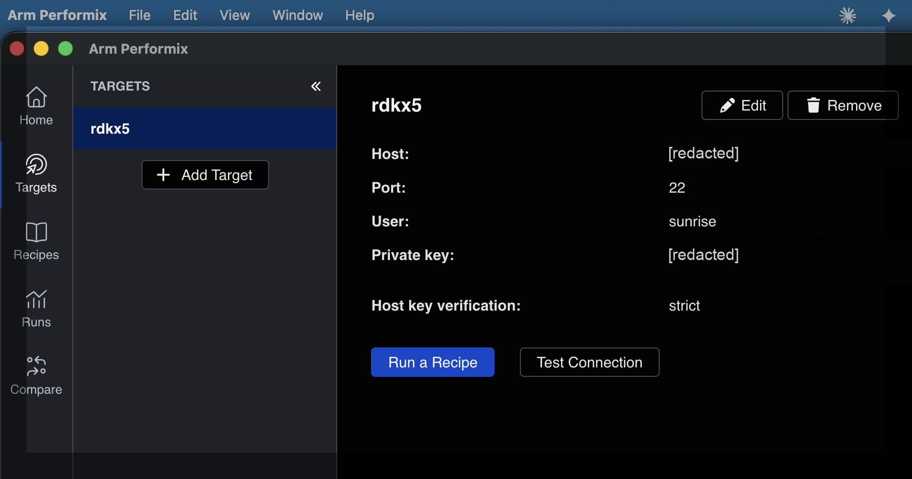
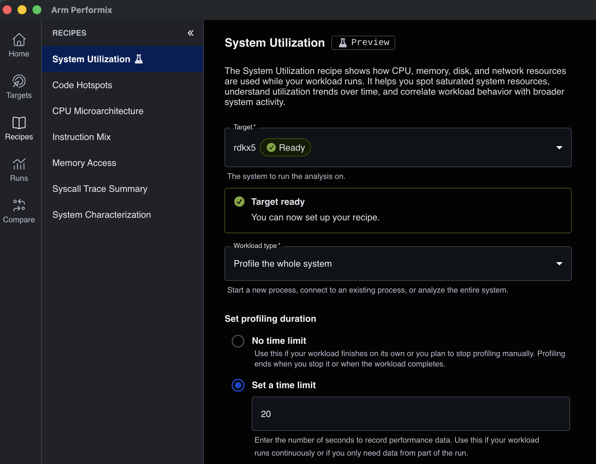
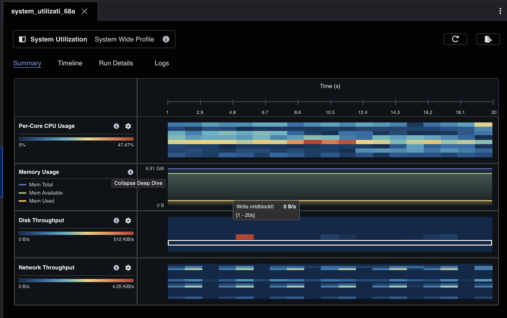
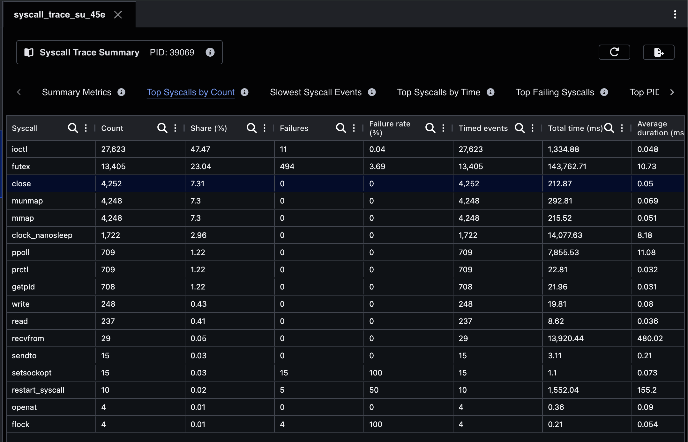

## Overview

The earlier pages measured how much CPU each process uses. On this page you look at the workload in more detail. You first use Arm Performix to observe system utilization and system calls while the pipeline runs. Then you use Linux `perf` to locate the CPU hotspots in the inference node, and to see where each transport mode copies image data.

## Profile with Arm Performix

[Arm Performix](/install-guides/performix/) runs on your workstation and profiles a remote Arm Linux target over SSH. You choose a recipe, which defines what to collect, and Performix deploys the tools it needs to the target, collects the data, and shows the results. Ubuntu 22.04 on Arm64 is a supported target.

Install Performix on your workstation by following the [install guide](/install-guides/performix/). You can work in the Performix application or with its `apx` command-line tool. The steps below show the application and give the matching `apx` command for each step. On macOS, add `apx` to your `PATH`:

```bash
export PATH="/Applications/Arm Performix.app/Contents/assets/apx:$PATH"
```

### Connect Performix to the RDK X5

In the Performix application, select **Targets** in the left sidebar, then select **Add Target**. Enter the IP address or host name of your RDK X5 as the host, `22` as the port, `sunrise` as the user, and the private key you use for SSH. After you save the target, select **Test Connection**. Performix deploys its agent to your home directory on the RDK X5 the first time it needs it. This doesn't require `sudo`.



The matching `apx` commands on the **workstation** are:

```bash
apx target add sunrise@<x5-address> --name rdkx5 --find-keys --default
apx target test
apx target prepare --target rdkx5
apx target info rdkx5
```

```output
OS Family  OS Description      Kernel Version
Linux      Ubuntu 22.04.5 LTS  6.1.83

CPU Architecture
AArch64
...
core_number  cluster_id  midr        name
0            0           0x412fd050  Cortex-A55
...
7            0           0x412fd050  Cortex-A55
```

### Check which recipes are available

Select **Recipes** in the left sidebar to see the available recipes. Not every recipe can run on every target, because some recipes need kernel features or CPU-specific data. When you select a recipe and the RDK X5 target, Performix checks the target and shows whether it's ready. You can run the same check with `apx recipe ready`, for example:

```bash
apx recipe ready system_utilization --target rdkx5 --system-wide
```

On the RDK OS 3.5.0 image used for this Learning Path, the checks gave these results:

| Recipe | Available on this image | Reason |
| --- | --- | --- |
| System Utilization | Yes | Performix deploys the missing tool on the first run. It warns that `numastat` isn't installed, so the results don't include NUMA statistics. |
| Syscall Trace Summary | Yes, for a specific process | System-wide tracing isn't supported. Attach it to a process ID. |
| Code Hotspots | No | Needs the kernel's tracing file system, tracefs, which this kernel doesn't include |
| Instruction Mix | No | Needs tracefs |
| Memory Access | No | Needs tracefs, and the kernel doesn't enable the Arm Statistical Profiling Extension (SPE) |
| CPU Microarchitecture | No | Performix has no telemetry specification for Cortex-A55 |
| System Characterization | Not tested | Needs the `numactl` package on the target, which isn't installed |

### Observe system utilization while the pipeline runs

Start the data-sharing arm from the previous page at 30 frames per second, and leave it running.

In Performix, select **Recipes** and then **System Utilization**. This recipe is marked as a preview in this version of Performix. Set up the run:

1. For **Target**, select the RDK X5 target. Wait until it shows **Ready**.
2. For **Workload type**, select **Profile the whole system**.
3. Under **Set profiling duration**, select **Set a time limit** and enter 20 seconds.
4. Start the run.



The matching `apx` command is:

```bash
apx recipe run system_utilization --target rdkx5 --system-wide --timeout 20 --deploy-tools
```

```output
Collecting utilization data - done! [20.604s]
Collecting sysutil timeline data - done! [20.519s]
...
Run ID: 8426778b168a
```

When the run finishes, Performix opens the results. The **Summary** tab shows a timeline with one sample per second for the whole RDK X5: per-core CPU usage as a heat map, memory usage, disk throughput, and network throughput. The **Timeline**, **Run Details**, and **Logs** tabs give more detail about the run.



In this run, no core was saturated while the pipeline ran at 30 frames per second. Total CPU utilization across the eight cores averaged about 11.5%. The busiest core averaged about 30%, with a highest one-second sample of about 47%.

Use this view to see whether the pipeline saturates any core or resource. Per-process detail comes from the measurements on the previous page and from `perf` later on this page.

### Summarize the system calls of the inference node

Keep the pipeline running, and find the process ID of the inference node on the **RDK X5**:

```bash
pgrep -f "^/opt/tros/humble/lib/dnn_node_example/example"
```

In Performix, select **Recipes** and then **Syscall Trace Summary**. Select the RDK X5 target, set **Workload type** to **Attach to a running process**, and enter the process ID of the inference node in **Process**. Performix shows the process name and command line, so you can check that it's the `example` process. Under **Set profiling duration**, select **Set a time limit**, enter 20 seconds, and start the run. This recipe doesn't support profiling the whole system.

The matching `apx` command, with `<PID>` replaced by the process ID:

```bash
apx recipe run syscall_trace_summary --target rdkx5 --pid <PID> --timeout 20 --deploy-tools
```

```output
Collecting syscall trace data - done! [8.039s]
Collect syscall trace data - done! [16.12s]
Parsing syscall trace output - done! [7.888s]
...
Run ID: 1f8debc6645e
```

The result shows how often the inference node calls each Linux system call, how long the calls take, and how many fail. The recipe uses `strace`, which slows down the traced process while it's attached. In the run for this Learning Path, the inference node continued at about 30 frames per second after the trace.

To see the results again later, select **Runs** in the left sidebar and open the run. The results have several tabs, including **Summary Metrics**, **Top Syscalls by Count**, **Slowest Syscall Events**, **Top Syscalls by Time**, and **Top Failing Syscalls**.



In this 20-second trace of the inference node:

- `ioctl` was the most frequent call, with 27,623 calls, or 47% of all calls. `ioctl` is how a program talks to device drivers. The trace doesn't show which device each call goes to.
- `futex` had the longest total time, about 144 seconds. `futex` is how threads wait for locks and other threads. Its time is waiting time summed over all threads, so it can be longer than the trace and isn't CPU work.
- `mmap`, `munmap`, and `close` each appeared about 4,250 times. These calls map and release memory and close file descriptors.
- Socket calls were rare: 29 `recvfrom` and 15 `sendto` calls. This matches the shared-memory page: the images reach the inference node through Fast DDS data sharing, not through sockets.

Treat these numbers as a picture of what the process does, not as precise timings. `strace` adds overhead to every system call while it's attached. Keep the pipeline running for the Code Hotspots check below.

### Why Code Hotspots isn't available on this image

Code Hotspots is the recipe that shows which functions use the most CPU time. On the workstation, try it with the inference node's process ID from the previous step. If the node has exited, restart the data-sharing arm and find its new process ID before running the command:

```bash
apx recipe run code_hotspots --target rdkx5 --pid <PID> --timeout 30 --deploy-tools
```

On the RDK OS 3.5 image used for this Learning Path, the recipe fails:

```output
[Error]: The `neoprof` tool failed during profiling.
[Explanation]: The specified recipe invokes the `neoprof` tool. This tool failed unexpectedly; sl-record returned exit code `1` during profiling.
```

To see why, run the recorder that Performix deployed directly on the **RDK X5**, for 5 seconds. Performix starts it with root privileges and system-wide capture, so this example does the same:

```bash
SL=$(ls -d ~/.local/share/apx/tools/sl-record/*/bin/sl-record | head -1)
sudo $SL -o /tmp/sltest.apc -t 5 --capture-log -r normal -S yes 2>&1 | grep ERROR
```

```output
ERROR: [HWCPIPE] Instance failed to initialize with data: Product:{t60x}
ERROR: Mali device instance creation failed error code 36, message: [IOCTL] Ioctl device returned (EINVAL)
ERROR: System-wide capture requested, but tracefs is not available.
```

The first two errors show that Mali counter initialization failed in this test; they don't identify the GPU or establish whether one is present. The last error shows that system-wide capture needs the kernel's tracing file system, tracefs. You can check for tracefs on the **RDK X5**:

```bash
grep -w tracefs /proc/filesystems || echo "tracefs not available"
zcat /proc/config.gz | grep "CONFIG_FTRACE"
```

```output
tracefs not available
# CONFIG_FTRACE is not set
```

The RDK OS 3.5.0 kernel tested here is built without function tracing, so tracefs doesn't exist and the recorder stops. Mounting tracefs can't help, because the kernel doesn't include the feature. Code Hotspots therefore didn't run on this image. D-Robotics confirmed the same kernel configuration on their board. It wasn't tested whether a kernel with `CONFIG_FTRACE` enabled is enough to make Performix work, or whether other requirements are also missing. The CPU's performance monitoring unit (PMU) works, as you see next, so you can profile with `perf` instead.

Stop the pipeline after this check. You will start it again for the `perf` recording.


## Prepare perf on the RDK X5

The RDK OS image includes `perf` that matches the kernel:

```bash
perf --version
ls /sys/bus/event_source/devices/
cat /proc/sys/kernel/perf_event_paranoid
```

```output
perf version 6.1.83
arm_dsu_0
armv8_pmuv3
breakpoint
cs_etm
software
2
```

`armv8_pmuv3` is the Cortex-A55 PMU. With `perf_event_paranoid` set to 2, a normal user can profile their own processes in user space. That is enough for this page, and you don't need `sudo`. Kernel functions don't appear in these profiles.

## Profile the inference node

Start the data-sharing arm at 30 frames per second, as on the previous page. Then record both processes for 20 seconds at about 1,000 samples per second, with call stacks. The `cycles:u` event counts CPU cycles in user space only:

```bash
PUB=$(pgrep -f "^/opt/tros/humble/lib/hobot_image_publisher/hobot_image_pub")
SUB=$(pgrep -f "^/opt/tros/humble/lib/dnn_node_example/example")
perf record -e cycles:u -F 999 -g -p $PUB,$SUB -o shm.data -- sleep 20
```

Show which threads used the CPU. Each percentage is a share of all samples in the recording, which covers both processes:

```bash
perf report -i shm.data --no-children --sort comm -g none --stdio | grep -E "^\s+[0-9]"
```

```output
    89.53%  example
     6.99%  hobot_image_pub
     1.62%  DNN_BPUSchWk
     0.31%  DNN_WkCor0_3
     ...
```

`example` is the main thread of the inference node. The `DNN_*` threads belong to the same process. They submit work to the accelerator and wait for it, and together they use about 3% of the samples.

Show the hottest functions in the inference node:

```bash
perf report -i shm.data --comms example --no-children --sort dso,sym -g none --stdio | grep -E "^\s+[0-9]" | head
```

```output
    47.50%  libdnn_node.so   [.] hobot::dnn_node::parser_fcos::CqatGetBboxAndScoresScaleNHWC
     6.42%  libm.so.6        [.] exp
     2.55%  libc.so.6        [.] 0x0000000000097c8c
     1.62%  libc.so.6        [.] pthread_mutex_lock
     1.12%  libc.so.6        [.] malloc
     0.98%  libhbmem.so.1.0.0 [.] mem_search_mem_node_with_vaddr
     ...
```

About half of all samples in this recording, which covers both the publisher and the subscriber, are in one function. `perf report` shows percentages of all recorded samples by default, even when you filter by thread with `--comms`. Within the `example` thread alone, the share is about 54%. The function is `CqatGetBboxAndScoresScaleNHWC`, the FCOS postprocessing step. It decodes the model output into scored bounding boxes, and it calls `exp`, which accounts for most of the `libm` samples. The model runs on the accelerator, but turning its output into detections runs on the Arm CPU. If you need to reduce CPU load in this pipeline, start with this function, not with the transport. Making it faster, for example with Arm Neon vector instructions, wasn't tested for this Learning Path.

## Optional: find the memory copies

{}
This section is an optional deep dive. It uses `perf` call stacks and disassembly to show where each transport mode copies image data. You can skip to the next section if you only need the CPU hotspots.
{}

Several `libc.so.6` entries appear as addresses, because the C library has no debug symbols. You can identify them by disassembling one. The addresses below are specific to the `libc` build in RDK OS 3.5.0. On another build, use the addresses from your own `perf report` output instead:

```bash
objdump -d --start-address=0x97c70 --stop-address=0x97c98 /lib/aarch64-linux-gnu/libc.so.6
```

```output
   97c70:	a9011c66 	stp	x6, x7, [x3, #16]
   97c74:	a9411c26 	ldp	x6, x7, [x1, #16]
   97c78:	a9022468 	stp	x8, x9, [x3, #32]
   97c7c:	a9422428 	ldp	x8, x9, [x1, #32]
   97c80:	a9032c6a 	stp	x10, x11, [x3, #48]
   97c84:	a9432c2a 	ldp	x10, x11, [x1, #48]
   97c88:	a984346c 	stp	x12, x13, [x3, #64]!
   97c8c:	a9c4342c 	ldp	x12, x13, [x1, #64]!
   97c90:	f1010042 	subs	x2, x2, #0x40
   97c94:	54fffee8 	b.hi	97c70
```

The loop loads and stores pairs of registers and moves 64 bytes per iteration. This is the large-block loop of `memcpy`. Each sample in this loop is time spent copying memory.

To see who calls the copy, print the two frames above each sample in the loop. The address pattern `97c..` in this command matches the copy loop in this `libc` build only:

```bash
perf script -i shm.data -F comm,ip,sym,dso | awk 'BEGIN{RS="";FS="\n"}
  $2 ~ /97c[0-9a-f][0-9a-f] .*libc.so.6/ {c=$1; sub(/ .*/,"",c); a=$3; b=$4;
  gsub(/^[ \t]+[0-9a-f]+ /,"",a); gsub(/^[ \t]+[0-9a-f]+ /,"",b);
  gsub(/ \(.*\)$/,"",a); gsub(/ \(.*\)$/,"",b); print c " | " a " <- " b}' \
  | sort | uniq -c | sort -rn | head
```

Repeat the recording with the Image-message arm from the previous page, and compare. The following table shows the number of copy-loop samples for each caller in one 20-second recording per arm at 30 frames per second. A dash means that the recording contains no samples for that caller:

| Where the copy happens | Data-sharing arm | Image-message arm |
| --- | --- | --- |
| Publisher: serialize the image (`cdr_serialize` → `Cdr::serializeArray`) | – | 222 |
| Publisher: split it into RTPS fragments (`RTPSMessageGroup::add_data_frag`) | – | 523 |
| Publisher: copy fragments into the Fast DDS shared-memory transport (`SharedMemTransport::copy_to_shared_buffer`) | – | 191 |
| Publisher: caller not resolved by `perf`. The source code shows that both arms copy the cached image into the message before publishing. | 309 | 180 |
| Subscriber: reassemble fragments (`StatefulReader::processDataFragMsg`) | – | 230 |
| Subscriber: deserialize the image (`Cdr::deserializeArray`) | – | 481 |
| Subscriber: copy into a `hobot_cv` frame for hardware resizing (`hobotcv_front::processFrame`) | 949 | 602 |
| Subscriber: build the NV12 input for the model (`ImageProc::GetNV12PyramidFromNV12Img`) | 293 | 228 |

In the Image-message arm, the samples show each image being serialized, fragmented, copied through the transport, reassembled, and deserialized. The data-sharing recording has no samples in any of those copy paths. Because profiles sample instead of trace, this means the copies weren't observed, not that they're impossible. At 30 frames per second of 614,400-byte images, however, a copy of each frame would almost certainly show up.

Both arms still copy image data inside the subscriber. The profile shows copies under `hobotcv_front::processFrame` and `GetNV12PyramidFromNV12Img`. According to the source code, these include copying the image into the VSE input buffer, copying the VSE output back, and copying the Y and UV planes into the model input. This is the boundary from the shared-memory page: data sharing covers the hop between the processes, not the work inside them.

The thread shares agree with the CPU measurements on the previous page. The publisher accounts for 18.8% of samples in the Image-message arm and 7.0% in the data-sharing arm.

## Limits of this profile

- The profiles cover user space only, because `perf_event_paranoid` is 2. Copies and work in the kernel, including hardware driver calls, aren't included.
- `libc` has no debug symbols. The copy loop was identified from its instructions, and some callers in the publisher couldn't be resolved.
- Each arm was recorded once for 20 seconds with the default CPU governor. Use sample counts to compare where time goes within one recording, not as precise timings.
- Work on the accelerator and on the hardware resizer doesn't appear in a CPU profile. The `DNN_*` threads show only the CPU time spent scheduling and waiting for the accelerator.

## Interpret what you measured

Use your results from all pages to answer these questions:

- **Capture:** The camera produces JPEG frames, and `hobot_usb_cam` publishes them without decoding. Which measurement on the camera streaming page tells you how much CPU the camera node itself uses?
- **Network:** At 1920x1080, which subscriber setting sustained about 30 received messages per second on the Pi, and how did the IP reassembly counters differ between the settings?
- **Local transport:** Which copies did the profile show in the Image-message arm that don't appear in the data-sharing arm?
- **Subscriber work:** Why does the inference node use more CPU than the publisher, even though the model runs on the accelerator?
- **Hardware acceleration:** Which stages of the shared-memory pipeline run on dedicated hardware, and why doesn't their work appear in `pidstat` or `perf`?

Also note what your evidence can't tell you. User-space CPU profiles don't show time in the kernel, on the accelerator, or in the hardware resizer. The comparison of data sharing with image messages doesn't isolate transport cost, because the two arms use different QoS settings.

## What you have learned

You have:

- Connected Arm Performix to the RDK X5, observed system utilization and the inference node's system calls while the pipeline ran, and found that Code Hotspots can't run on the tested RDK OS 3.5.0 image because the kernel has no tracefs.
- Used `perf` to find the main CPU hotspot in the inference node: FCOS postprocessing on the Arm CPU.
- Attributed memory copies to their callers, and saw which copies appear only in the Image-message arm and which remain in both arms.
