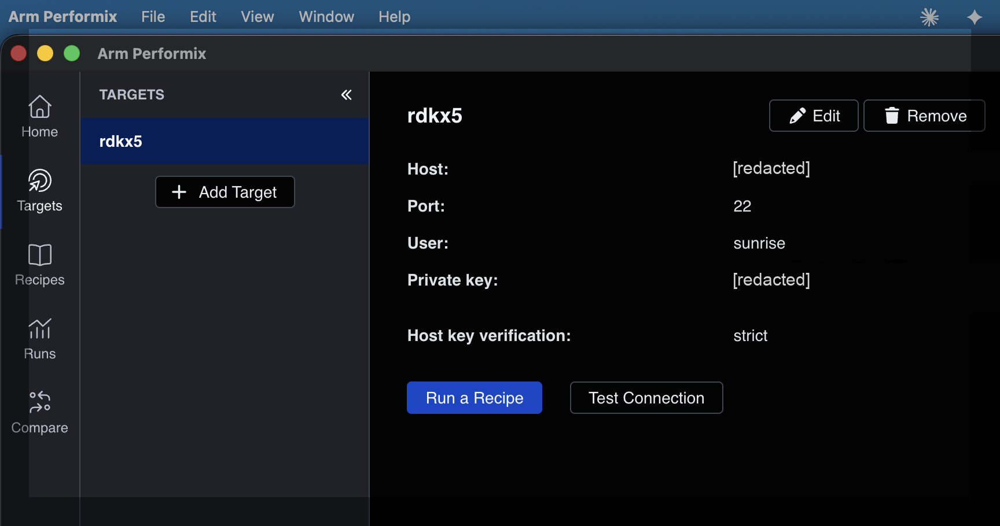
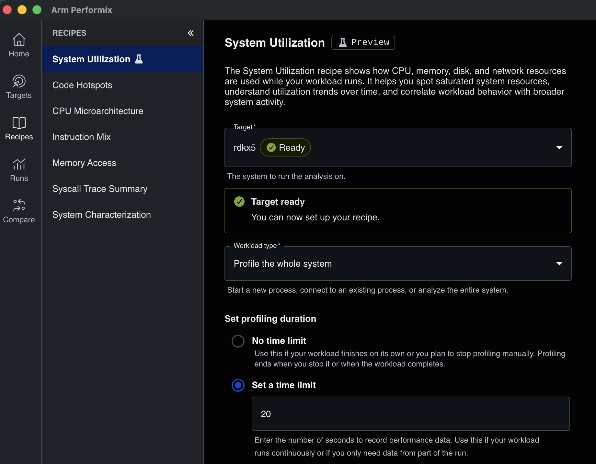
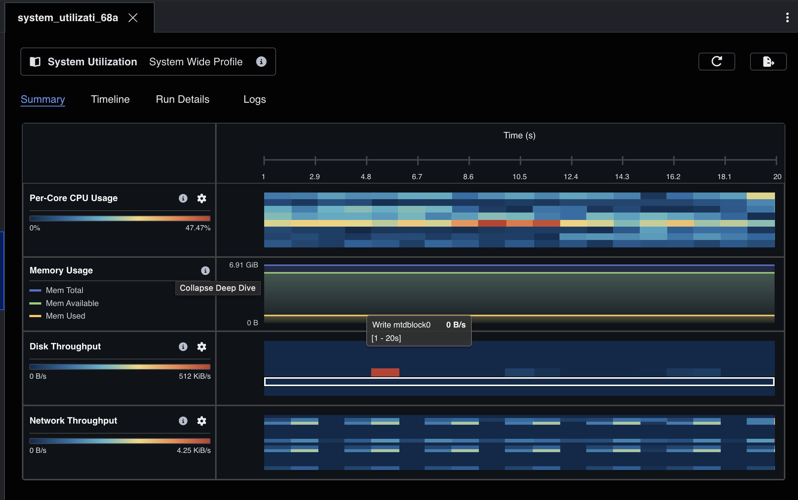

## Overview

In this section, you will use Arm Performix to observe how much CPU and memory the RDK X5 uses while the local image-processing example runs.

[Arm Performix](/install-guides/performix/) is a performance profiling and analysis toolkit for developers building on Arm-based infrastructure. It runs on your workstation and profiles a remote Arm target over SSH. You choose a *recipe*, which defines what to collect, and a target. Based on this, Performix deploys the tools it needs, collects the data, and shows the results. 

Install Performix on your workstation by following the [install guide](/install-guides/performix/). You can work in the Performix application or with its `apx` command-line tool. The steps below show the application flow.

## Connect Performix to the RDK X5

In the Performix application, select **Targets** in the left sidebar, then select **Add Target**. Enter the IP address or host name of your RDK X5 as the host, `22` as the port, your SSH username, and the private key you use for SSH. After you save the target, select **Test Connection**.

On the **RDK X5**, [start the local image-processing example](/learning-paths/cross-platform/togetheros_vision/4_run_shared_memory/#run-the-example) if it isn't already running. Leave it running during the capture. This launch publishes the stored image at 5 frames per second and includes the object detector, encoder, and web viewer.

## Observe system utilization

In Performix, select **Recipes** and then **System Utilization**. This recipe was available on the RDK OS 3.5.0 image tested for this Learning Path.

1. For **Target**, select the RDK X5 target. If prompted, install the collection tools and wait until the target shows **Ready**.
2. For **Workload type**, select **Profile the whole system**.
3. Under **Set profiling duration**, select **Set a time limit** and enter 20 seconds.
4. Start the run.

## Read the results

When the run finishes, Performix opens the results. The **Summary** tab shows per-core CPU usage as a heat map, memory usage, disk throughput, and network throughput over time. The **Timeline**, **Run Details**, and **Logs** tabs give more detail about the run.

The screenshot below illustrates the report layout from a separate run of the publisher and detector at 30 frames per second. Use your own results to assess the 5-fps example running here.

Use the report to check:

- **CPU:** Look for a core that stays close to 100% usage. A low average across all eight cores can hide one busy core.
- **Memory:** Check the available memory and whether memory use keeps rising during the capture.
- **Disk and network:** Look for unexpected activity. The browser viewer and SSH connection also generate network traffic.

In this run, no core was saturated while the pipeline ran at 30 frames per second. Total CPU utilization across the eight cores averaged about 11.5%. The busiest core averaged about 30%, with a highest one-second sample of about 47%.

These measurements cover the whole X5, including other processes running on the board. CPU usage alone doesn't show how busy the inference accelerator is.

To see the results again later, select **Runs** in the left sidebar and open the run.

## Stop the example

Stop the ROS 2 launch with Ctrl+C, then [stop its web server](/learning-paths/cross-platform/togetheros_vision/4_run_shared_memory/#stop-the-example) as described on the local example page.

## What you have learned

You have:

- Connected Arm Performix to the RDK X5 and captured system utilization while the TogetheROS vision pipeline runs.
- Used the report to inspect CPU, memory, disk, and network activity.
